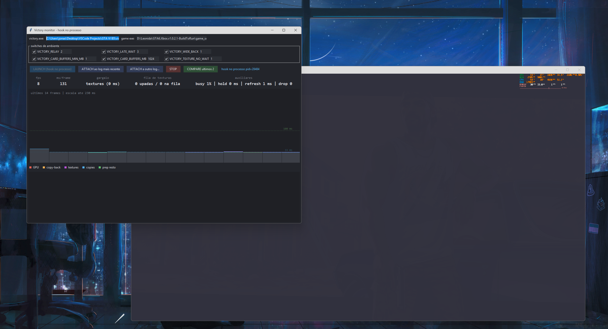

# victory-monitor

GUI monitor (tkinter, stdlib only) that **hooks the [Victory](https://github.com/Marvisak/VIctory)
emulator process** (`victory.exe run <title> --execute`) and reads its stdout
live — the same text that goes to the log — parsing every per-frame statistics
burst and showing where the frame time goes, in real time.

Built while chasing frame-time bottlenecks in the GTA VI Xbox 1.0.2.1 title.



## What it shows

- **Live numbers**: fps, ms/frame, a **bottleneck verdict for the current
  frame** ("GPU (draws)", "copy-back", "textures", ...), texture queue depth,
  card busy %, remap lock, dropped draws.
- **Stacked bar chart** of the last 240 frames: GPU / copy-back / textures /
  copies / rest-of-preparing, with 33 ms and 100 ms reference lines.
- **Pipeline-stall watchdog**: alerts when no statistics burst lands for more
  than 15 s and shows what the log was doing at that moment (e.g. the
  first-bind avalanche that precedes a silent stall — caught on run 5, where
  the title spent 2+ minutes building hundreds of new pipelines without
  completing a frame).
- **Run summaries**: on exit, a JSON summary (medians of slow/medium/fast
  frames, per-stage breakdown, switch set) is saved under `summaries/`.
- **Compare**: chronological before/after table of the last two summaries —
  the A/B that measured `VICTORY_RELAY=2 LATE_WAIT=3 CARD_BUFFERS_MIN_MB=1`
  (3.7 s → 1.6 s in the world) and `VICTORY_TEXTURE_NO_WAIT=1`
  (2.5 s → 1.4 s, remap lock eliminated).

## Modes

- **LAUNCH** — starts `victory.exe` itself with the environment switches you
  tick (the six known switches ship pre-filled), pipes and parses its stdout,
  and mirrors everything to `logs/run_gui_<timestamp>.log`.
- **ATTACH** — tails an existing log (the latest in the log dir, or one you
  pick) when the game was started some other way.

## Parse coverage

Works against Victory-fork (victory-gta6) log format; degrades gracefully on
upstream Victory (the fps/`preparing`/GPU/copy-back line is upstream, the
fork-only counters — remap lock, card busy, texture queue, `NO_WAIT` — simply
stay absent).

Known log lines parsed:

| line | field |
|---|---|
| `X fps, Y ms/frame (P preparing: copies C ms MB, textures T ms MB; G on the GPU; B copying back MB), D draws/frame, dropped K without a host pipeline (M being made) and I indirect` | frame record |
| `the card about N% busy` | `card_busy` |
| `stood waiting for the card X ms` | `submit_wait` |
| `texture refreshes per frame, all threads: X ms ... Y ms waiting for title memory to hold still` | `tex_refresh`, `hold_still` |
| `N read through the kernel, M left for the next refresh` | `nowait_kernel`, `nowait_defer` |
| `N uploaded so far (X MB), M waiting` | `tex_uploaded`, `tex_waiting` |
| `shader writes looked for on the CPU per frame: ... X MB in N ranges` | `shadow_snap` |
| `heap buffers P passes X ms` | `heap_ms` |

## Usage

```bash
python victory_monitor.py           # GUI
python victory_monitor.py --check   # validate the parser against existing logs
```

Paths to `victory.exe` and the title's exe are constants at the top of the
file (`EXE`, `GAME_EXE`) — edit them for your layout. Defaults assume the
victory-fork checkout sitting next to the script and the GTA VI dump on `D:`.

Requirements: Python 3.8+ with tkinter, Windows.

## Findings so far (GTA VI 1.0.2.1, RTX 4060 Ti 8 GB)

| run | switches | world (slow-frame median) | top bottleneck |
|---|---|---|---|
| 1 | none | 3.7 s | texture refresh blocked on the remap lock; card idle behind the submit thread |
| 2 | `RELAY=2 LATE_WAIT=3 WIDE_BACK=1 CARD_BUFFERS_MIN_MB=1 CARD_BUFFERS_MB=1024` | 1.6 s | still the remap lock (hold-still ~400 ms median) |
| 3 | run 2 + `TEXTURE_NO_WAIT=1` | 1.4 s | **moved**: GPU (1.1 s) + copy-back (1.1 s), card busy 13% → 62% |
| 4 | run 3, via this monitor | — | silent pipeline-build stall on world streaming (no device loss, no TDR) |

## License

MIT. Victory itself is GPL-3.0-or-later by Marvisak and contributors — this
tool only reads its stdout and is not a derivative work; it ships no emulator
or game code.
